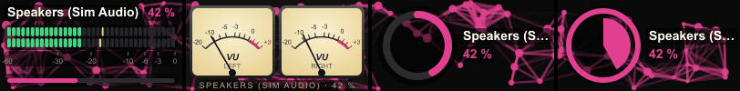

# SA-C — System Audio Controller for Stream Deck

Your computer's sound on your Stream Deck: the volume with a live level meter, each app's volume (Spotify, Firefox, Discord, …), a mic mute key, and a key to switch between headphones and speakers. SA-C also shares that level with other Stream Deck plugins through **deckbus**, so, for example, the Panorama of [Music Assistant Controller](https://github.com/rocklobster42195/streamdeck-music-assistant-controller) can move with the music on your PC.

> Unofficial community plugin. Not affiliated with Elgato or Microsoft.

**Status:** early, available as a [beta](../../releases). Windows only for now; macOS is planned.

> **⚠️ Before you install: SA-C needs a small Windows helper to run.** To reach Windows' audio system it starts a PowerShell script once that compiles a few C# files (they are plain text in the plugin folder, nothing is installed, nothing goes to the internet). **On company or managed PCs, or with security software that blocks PowerShell scripts or compiling C#, the helper can't start, and SA-C then can't work.** Keys and dials show **"Audio not available"** in that case. See [How it works](#how-it-works) and [Troubleshooting](#troubleshooting).

## In action

The Output dial in four of its looks (Digital, Classic VU, Open ring and Pie), turned down and up again: the volume and the level of the music follow it. The Open ring and the Pie show the kind of the output device as an icon (headphones, speakers, a monitor's speakers): in the gap at the bottom of the open ring, in the middle of the pie. A Panorama effect runs behind the dials.



The picture comes from the simulator with invented music and an invented system audio (`node tools/sd-sim/readme-gifs.mjs`).

## Contents

- [Actions](#actions)
- [Requirements](#requirements)
- [Works with other plugins (deckbus)](#works-with-other-plugins-deckbus)
- [How it works](#how-it-works)
- [Troubleshooting](#troubleshooting)
- [Planned](#planned)
- [Development](#development)
- [Credits and licence](#credits-and-licence)

## Actions

### Output *(dial, Stream Deck + only)*

The volume of your default output device (the one Windows plays through right now). If you switch from speakers to headphones in Windows, the dial follows.

| Control | What it does |
|---|---|
| Rotate | Volume (2 % per step, adjustable 1–10 %) |
| Push | Mute / unmute |
| Tap the display | Mute / unmute |

**Display** (in the dial's settings):

- **Digital**: LED bars for left and right with peak hold, a dBFS scale, and the volume as a slim bar underneath.
- **Classic**: two analog VU meters, like on an old tape deck.
- **Ring**, **Pie** and **Horseshoe** (a ring open at the bottom): just the volume, no meter.

SA-C measures the level only while a dial that shows it is visible, or while another plugin uses it.

By default the display shows the device's name (e.g. "Speakers (Realtek Audio)"). Give it your own name in the settings.

### App *(dial, Stream Deck + only)*

One app's volume, like in the Windows volume mixer: Spotify, Firefox, Discord, a game. Choose the app in the dial's settings; the list shows the apps that have played sound since they started, playing ones first.

| Control | What it does |
|---|---|
| Rotate | The app's volume |
| Push / tap | Mute / unmute the app |

- The app's volume is relative to the output volume: 100 % means "as loud as the output".
- The display has the same five looks as the Output dial, with the app's icon next to its name (in the circle for Ring, Pie and Horseshoe); the meter shows only this app's sound.
- While the app is closed, the dial turns **grey** with its icon and last volume, and waits. It comes back when the app plays again.
- Apps with several audio streams (browsers) are changed together.

### Settings of the dials

The dial's settings panel stays short: what it controls and how it looks. **More settings …** opens a bigger settings window with the rest: the step per tick, **Panorama** and **Other plugins**, with a menu to jump between them.

### Panorama behind the dials

An effect (particles, matrix rain, Boing ball, Boing globe) can run behind the dials, across all displays of the deck like one picture, also behind the dials of other plugins of the family ([Music Assistant Controller](https://github.com/rocklobster42195/streamdeck-music-assistant-controller), X-Air Controller, Home Assistant Controller). In the settings window under **Panorama**, choose the effect for the whole row of dials, untick the dials that shouldn't show it (the effect runs on behind them), and set its speed or density once for the row. Only the text and the meters get a dark backing, so the effect stays visible around them.

### App Mute *(key)*

Mute one app with a key: the app's icon large with its name, and a small level while it plays (can be turned off). Press to mute or unmute. While muted, the key is **red**; while the app is closed, it is **grey**.

SA-C takes the icons from the programs themselves and keeps a copy, so a key shows the right icon even while its app is closed.

### Microphone *(key)*

Press to mute or unmute your default microphone. While muted, the key is **red** with a crossed-out mic, so you see it from across the room. Otherwise it shows a small level. The level moves only while an app records (a call, a recording): Windows measures a mic only then.

### Output Device *(key)*

Switches the default output device.

- **One device chosen:** a press makes it the default (e.g. one key for the headphones, one for the speakers).
- **Two devices chosen:** a press switches between them.

The key shows the device with a matching icon (headphones, speakers, monitor) and its name; while it is the default it is "on": a tinted plate and a frame in SA-C's colour. If you give a key a title in Stream Deck, SA-C leaves its own name out (also on the App Mute key). SA-C sets it as the default for everything: music, videos and calls.

### App Output *(key)*

Plays apps on another device, without changing the default: Discord and Teams on the headset, Spotify on the speakers.

- Choose one or more **apps** and a list of **devices** (including **Windows default**).
- Each press moves the apps to the next device of the list; the key shows it with its name, icon and colour, and a dot per step.
- Windows keeps the choice for the app. An app that is closed gets it as soon as it plays again.

This uses Windows' own per-app setting ("App volume and device preferences"), through an internal Windows interface, as EarTrumpet does; a big Windows update may change it.

### Track *(dial)*

Cover, title, artist and progress of the music on the PC (Spotify, a browser tab, Media Player …) or any other player on the deck; without a chosen player it follows the one that started last, apps included.

| Control | What it does |
|---|---|
| Rotate | Seek (5, 10, 15 or 30 seconds per step) |
| Push | Next track |
| Tap the display | Play / pause |

The look is track info (text low, a bar at the bottom, "LIVE" for a stream) or the equalizer; the cover sits on the right or the left. In a row with a Panorama effect the dial shows the effect behind the text.

### Play / Pause *(key)*

Plays or pauses music on the PC (Spotify, a browser tab, Media Player …) or any other player on the deck; without a chosen player the one that started last, apps included. The key shows the cover, dimmed with a play symbol while paused, and optionally the title and a progress bar. Two corners show an icon of your own, the app or the service. With **Double and triple tap** switched on (off by default), two taps skip to the next track and three go back to the previous one; a single tap then waits a moment before it plays or pauses, and **Tap speed** sets how quickly the taps must follow each other.

### Playback Control *(key)*

Next, previous, shuffle or repeat for music on the PC (Spotify, a browser tab, Media Player …) or any other player on the deck. Without a chosen player it follows the one that started last, apps included. Hold **Next** or **Previous** half a second to seek instead of skipping (5, 10, 15 or 30 seconds per tap; quick taps add up to one jump). Shuffle and repeat show their state; a player that can't do something dims the key.

### Volume *(key)*

Louder, quieter, mute or a preset volume for an app on the PC (its volume in Windows' mixer, never the device volume) or any other player on the deck. The mute key shows the volume as a ring, a pie or an open ring; muted it turns grey with a red speaker. With a preset set, holding Louder, Quieter or Mute half a second jumps to it.

## Requirements

- Windows 10 or 11
- Stream Deck 7.1 or later, and a Stream Deck + for the dial
- Windows PowerShell (part of Windows)

## Works with other plugins (deckbus)

SA-C talks to other Stream Deck plugins on your computer through **deckbus**, a small open bus between plugins. You don't need to set anything up: when the plugins run, they find each other.

**Offers:**
- whether the system audio is available, with the output device's name;
- whether the mic is muted, and which apps use it now (`mic`), so other plugins could show it;
- whether the computer is in a **call** (`call`: Teams, Discord, Zoom … with the app), so other plugins can pause or lower music during it; from Windows' own call detection, else a known call app using the mic;
- levels, each sent only while another plugin actually uses it:
  - your computer's output as `meters/system-output` (e.g. Music Assistant Controller's Panorama with **Audio source** set to your output device);
  - the mic as `meters/system-input` (marked as an input, so Music Assistant Controller's Panorama doesn't list it);
  - every app with sound, e.g. `meters/app-spotify`, so Music Assistant Controller's Panorama can move with Spotify only (not Windows' system sounds).

- the music playing on your computer as **players** (`players`): Spotify, a browser tab, Media Player … with title, cover and position. Sonos Controller's and Music Assistant Controller's media keys can control them (play/pause, next, seek, volume = the app's volume). Covers are served to the other plugins on `127.0.0.1` only. When you quit the app, its player stays as closed, and Play on another plugin's key starts the app and plays. Another plugin's keys may do this by default, like a remote; the global setting `othersMayControlPlayers: false` switches it off.

**Uses:** the Panorama of the other plugins' dials in the same row: one effect across all of them (state `panorama-rows`; the plugin with the leftmost dial computes it).

**Only with your permission:** lowering the volume for a moment (*ducking*), e.g. Music Assistant Controller during an announcement. Nobody may by default. Switch it on per plugin under **Other plugins**: in the settings window of an Output or App dial, or in the settings of an App Mute key (the list shows the plugins on deckbus right now).

- A plugin can lower your output device or one app (by a few dB, for at most a few minutes).
- Afterwards SA-C puts back exactly the volume from before, also when that plugin stops or you switch its permission off.
- You win: if you change the volume during a duck (on the deck or in Windows), it stays as you set it.

deckbus stays on your computer. It uses local pipes, plugins must know a key stored in your user profile, and nothing goes over the network. The protocol is open: [deckbus protocol](https://github.com/rocklobster42195/streamdeck-kit/blob/main/docs/deckbus-protocol.md).

## How it works

Node.js, which Stream Deck plugins run on, can't reach the Windows audio system by itself. SA-C therefore starts a small helper once: a PowerShell script (`helper/sac-audio.ps1`) that compiles three short C# files (`helper/Interop.cs`, `helper/Icons.cs`, `helper/Helper.cs`) for Windows Core Audio. Both are plain text in the plugin folder, so you can read exactly what they do. There is no program to install and nothing that runs when Stream Deck is closed.

- The helper reads and sets the volume and mute of the default output and input device and of each app, and reads their levels (about 20 times per second, only while needed).
- Switching the default device uses the same Windows interface as the Windows sound settings (`IPolicyConfig`, not officially documented, but stable since Windows 7).
- Plugin and helper talk through simple JSON lines.
- The helper needs about half a second to start, once per plugin start.
- SA-C sends nothing to the internet.

## Troubleshooting

- **"Audio not available"**: the helper isn't running. SA-C restarts it by itself, so a short message right after the start is normal. If it stays: (1) click **Log** at the bottom of any of the plugin's settings: it opens the Diagnostics field, and its copy icon copies a report with the end of the log, which contains the helper's error; (2) on a company PC, ask whether PowerShell scripts and compiling C# (`Add-Type`) are allowed; (3) check that your security software hasn't blocked or quarantined files in the plugin's `helper/` folder; (4) [open an issue](../../issues/new/choose) with the report. Some company PCs block PowerShell scripts or compiling C#; then SA-C can't work there.
- **"No output device"**: Windows has no active output device. Plug in speakers or headphones, or choose one in the Windows sound settings.
- **The meter doesn't move**: nothing is playing, or the app plays to a device that isn't the default.
- **An app is missing from the App list**: it hasn't played sound yet since it started. Play something, then open the list again.

## Planned

- macOS.

## Development

```sh
npm install
npm run build        # plugin bundle and PI
npm run check        # build, tests, lint, manifest validation
npm run icons        # action and plugin icons
npm run sim:output   # all actions against a fake system audio, deckbus checks → sim-out/output/
npm run sim:apps     # App dials and keys with icons; an app closes and turns grey → sim-out/apps/
npm run sim:duck     # another plugin ducks the output and an app: permission, restore, "you win" → sim-out/duck/
npm run sim:app-output # the App Output key: two apps, three devices, each press routes both (fake)
npm run sim:call     # a call on deckbus (fake Teams call); -- --real waits for a real one and only watches
npm run sim:players  # media sessions as deckbus players: cover, commands, permission (fake); -- --real reads the real ones, -- --real --control also controls Spotify, -- --real --launch: quit Spotify, Play starts it (never the device volume)
npm run link -w sac-plugin   # install the dev build into Stream Deck
```

The simulator never touches your real volume: it runs the plugin with `SAC_HELPER=tools/fake-helper.mjs`, a stand-in that speaks the helper's protocol.

The plugin is built on [`@rocklobster42195/streamdeck-kit`](https://github.com/rocklobster42195/streamdeck-kit) (rendering, meters, settings panels, deckbus).

## Credits and licence

- Icons: [Material Design Icons](https://pictogrammers.com) (Apache 2.0).
- Licence: MIT, see [LICENSE](LICENSE).
